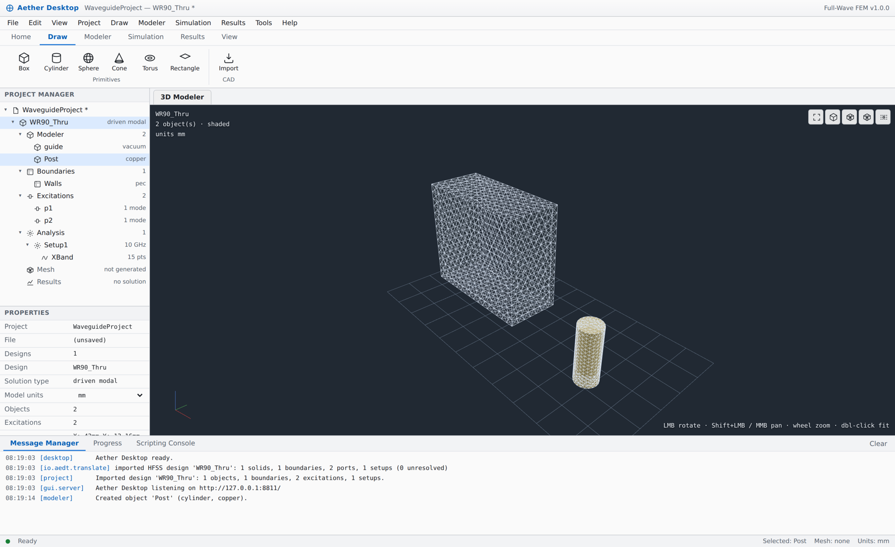
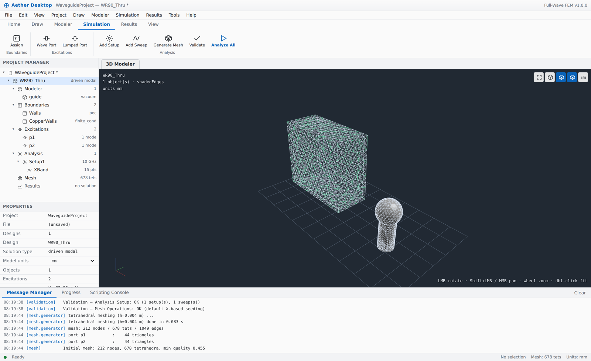
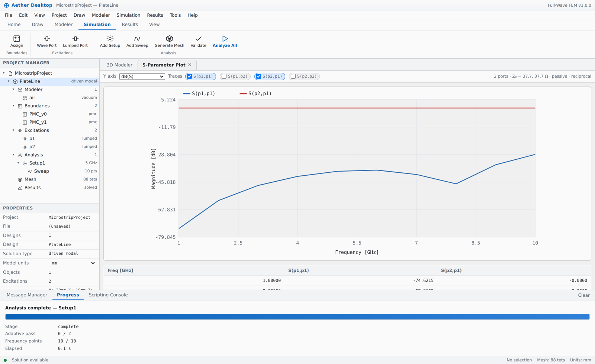
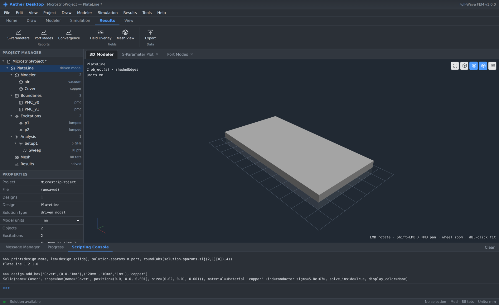

# Aether EM 1.7.9 — HFSS import 정리(PML 제거), mesh 동작, 마우스로 포트 지정

최신 안내: [docs/UPGRADE_1.7.9_KO.md](docs/UPGRADE_1.7.9_KO.md)

HFSS import 시 PML 관련 형상·재료·경계를 모두 제거하고 원래 모델만 가져오며, PML이 대신하던 개방 조건은 외곽면 Radiation 경계로 복원함. 공기 Region을 padding 값으로 재구성하여 해석 영역이 생기도록 했고, HFSS의 BasisOrder=0/-1을 지원 차수로 보정함. 읽을 수 없는 ACIS/Parasolid body 하나 때문에 전체가 중단되던 Generate Mesh는 해당 body만 제외하고 진행하며 어떤 body가 빠졌는지 알려줌(사용자 프로젝트: 실패 → 68,981 tet, 6초). Modeler ▸ Repair Bodies로 STEP 하나에서 여러 body를 한 번에 연결 가능. 포트는 마우스로 signal 면과 gnd 면을 클릭하면 사이 sheet와 integration line을 자동 생성함(wave port도 동일 방식). 경계·포트가 아무 면에도 닿지 않으면 경고함. 새 폴더에서 SETUP_WINDOWS.cmd 후 START_WINDOWS.cmd 실행. 아래는 이전 버전 기록임.

---

# Aether EM 1.7.8 — 다중 선택, 마우스 이동, sweep 수정, import 속도

최신 안내: [docs/UPGRADE_1.7.8_KO.md](docs/UPGRADE_1.7.8_KO.md)

Sweep Face Along Normal이 별도 객체를 생성하도록 수정(이전에는 Move Faces와 동일하게 동작), Ctrl+드래그 사각형으로 object/face/edge/point 다중 선택, 두 점으로 이동(마우스로 방향 지정 + 수치 입력), box by points의 높이 방향 반전 버그 수정, CAD import 속도 약 2배(18-body STEP 12.3초 → 5.3초, 표시는 즉시), 프로젝트가 없을 때도 import/draw 동작. 새 폴더에서 SETUP_WINDOWS.cmd 후 START_WINDOWS.cmd 실행. 아래는 이전 버전 기록임.

---

# Aether EM 1.7.7 — 첨부 파일 3개로 재현한 실제 원인 수정

최신 안내: [docs/UPGRADE_1.7.7_KO.md](docs/UPGRADE_1.7.7_KO.md)

프로젝트가 완전히 로드됐는데 화면이 비어 있던 원인은 재료명 조회 실패(공백·하이픈이 든 HFSS 재료명)였고, 이 예외가 "로드 완료"와 "그리기" 사이에서 그리기를 막고 있었음 — 정규화 통일 및 열기 단계 분리로 수정. STEP import가 끝나지 않던 원인은 파일에 들어 있던 solid에 속하지 않는 자유 형상(면 321 m², 곡선 36 m, entity 1,995개)을 부품 기준 요소 크기로 메시하고 있던 것 — 해당 entity 제거 및 삼각형 예산 역산으로 수정(검사 8.6 s, import+표시 20 s). DXF 전체가 거부되던 원인은 0.1 µm 선분에 대한 OCC 거부 — ring tolerance 수정. 문서 교체 시 표시 캐시 전부 비움. 새 폴더에서 SETUP_WINDOWS.cmd 후 START_WINDOWS.cmd 실행. 아래는 이전 버전 기록임.

---

# Aether EM 1.7.6 — 도킹 창 크기 조절, 뷰포트 내 도면 작성, "왜 안 보이는가"

최신 안내: [docs/UPGRADE_1.7.6_KO.md](docs/UPGRADE_1.7.6_KO.md)

Message 창을 포함한 모든 도킹 창 크기 조절, Box/Rectangle/Cylinder by points의 모달 제거와 실시간 좌표 패널(마우스로 그리고 같은 패널에서 값 수정), 상태 표시줄 좌표 표시, 그리고 "불러왔는데 화면에 아무것도 안 나옴"의 원인을 객체 단위로 알려주는 View ▸ Display Diagnostics와 Solid Display. 새 폴더에서 SETUP_WINDOWS.cmd 후 START_WINDOWS.cmd 실행. 아래는 이전 버전 기록임.

---

# Aether EM 1.7.5 — 프로젝트 닫기, 저장 확인, 진행 표시, 뷰포트 속도

최신 안내: [docs/UPGRADE_1.7.5_KO.md](docs/UPGRADE_1.7.5_KO.md)

File ▸ Close Project와 Exit, 저장하지 않은 변경에 대한 Save / Don't Save / Cancel 확인창, 프로젝트 열기·CAD import·뷰포트 재생성의 단계 표시, 그리고 뷰포트 재표시 성능 개선(합성 45,790 삼각형 장면에서 재표시 3,313 ms → 22 ms, 한 객체 편집 후 3,328 ms → 87 ms). 새 폴더에서 SETUP_WINDOWS.cmd 후 START_WINDOWS.cmd 실행. 실제 사용자 대형 STEP 성능은 아직 미검증. 아래는 이전 버전 기록임.

---

# Aether EM 1.7.4 — individual edges and STEP viewport performance

최신 안내: [docs/UPGRADE_1.7.4_KO.md](docs/UPGRADE_1.7.4_KO.md)

개별 CAD edge 선택, 삼각형 BVH 선택 가속, 조립체 노드 공유 및 표시 부담 감소. 새 폴더에서 SETUP_WINDOWS.cmd 후 START_WINDOWS.cmd 실행. 대형 STEP은 START_FAST_WINDOWS.cmd 사용 가능. 실제 사용자 대형 STEP 성능은 아직 미검증. 아래는 이전 버전 기록임.

---

# Aether EM 1.7.3 — world axes, whole outlines and kept measurements

최신 사용 안내 및 실제 solum.aedt 검증 결과: [docs/UPGRADE_1.7.3_KO.md](docs/UPGRADE_1.7.3_KO.md)

새 폴더에서 SETUP_WINDOWS.cmd → START_WINDOWS.cmd. 월드 원점 격자 고정, X/Y/Z 화살표, 연결된 외곽선 선택, 우클릭 Select Point, 좌표/거리 표시 및 치수 보관·숨김 추가. 전체 HFSS/PML 호환은 아직 지원하지 않음. 아래는 이전 버전 기록임.

---

# Aether EM 1.7.2 — selection, measurement and import diagnostics

최신 안내: [docs/UPGRADE_1.7.2_KO.md](docs/UPGRADE_1.7.2_KO.md)

새 폴더에서 SETUP_WINDOWS.cmd → START_WINDOWS.cmd 순서로 실행. 곡면 음영, 더블클릭 선택, O/F/E/V 호버 강조, 두 점 측정 및 HFSS 누락/재료 진단 개선. 전체 HFSS/Parasolid 호환은 지원하지 않음. 아래는 이전 버전 기록임.

---

# Aether EM 1.7.1 — import repair

**이번 오류 수정 안내: [docs/IMPORT_FIX_1.7.1_KO.md](docs/IMPORT_FIX_1.7.1_KO.md)**

새 폴더에 압축을 풀고 `SETUP_WINDOWS.cmd` → `START_WINDOWS.cmd` 순서로 실행해야 함.

Fixed missing STEP assembly-name helper; added endpoint joining and extended DXF parsing, visible open-path references, 2D view fitting, UTF-16 project decoding and nested AEDTZ CAD paths. New dependency: ezdxf. Actual failing user CAD/HFSS files have not yet been supplied.

---

# Aether EM 1.7.0 — parametric engineering upgrade

Windows: extract the ZIP and run `START_WINDOWS.cmd` (Python 3.12 recommended). First setup needs Internet.

**최신 한국어 안내: [docs/UPGRADE_1.7.0_KO.md](docs/UPGRADE_1.7.0_KO.md)**

New: dimension expressions and variable rebuilds, real FEM parameter studies, cooperative cancellation, solver controls, diagnostics, CAD export and analytic primitive measurements. File-safety fixes from 1.6.1 are included.

Run `python validate_release.py` for a reproducible builtin WR-90 benchmark. This development release does not establish HFSS accuracy or complete native-project compatibility. Screenshots and general documentation below may show earlier versions.

---

# Aether-EM

**3-D full-wave electromagnetic field solver** — frequency-domain finite
elements on tetrahedra with curl-conforming (Nédélec) vector basis functions,
the same numerical foundation as Ansys HFSS — plus supported `.aedt` model import/export.

```bash
aether gui           # the full graphical workspace, in your browser
```


```python
import aether as ae

d = ae.Design("wr90", solution_type="driven_modal", units="mm")
d.add_box("guide", (0, 0, 0), ("22.86mm", "10.16mm", "30mm"), "vacuum")
d.add_wave_port("p1", axis="z", value=0)
d.add_wave_port("p2", axis="z", value="30mm")
d.assign_pec_outer()

setup = d.add_setup("Setup1", frequency="10GHz", max_passes=6, delta_s=0.02)
setup.add_sweep("XBand", "8.2GHz", "12.4GHz", 43)

sol = d.solve()
print(sol.summary())
sol.sparams.write_touchstone("wr90.s2p")
```

---

## 한국어 요약

Maxwell 방정식을 주파수 영역에서 직접 푸는 3D full-wave FEM 솔버임.
HFSS와 동일한 수치 기반(사면체 + Nédélec edge element)을 사용하며,
HFSS `.aedt`의 지원되는 모델 항목을 읽고 쓸 수 있음. 원시 구문 트리의 무수정 round-trip과 GUI 편집 저장은 다르며, native history 전체 호환을 보장하지 않음.

| 기능 | 내용 |
|---|---|
| 지오메트리 | CSG 프리미티브 + STEP/IGES/BREP/STL 임포트 (OpenCASCADE) |
| 메시 | 사면체 자동 메싱, λ 기반 시딩, 오차 지시자 기반 적응 세분화 |
| 물리 | 복소 유전율/투자율, Debye·Drude·Lorentz·Djordjevic-Sarkar 분산 |
| 경계 | PEC, PMC, 표면 임피던스(유한 도전율·두께·거칠기), 복사, lumped RLC, 대칭 |
| 여진 | Wave port(2D 모달 고유해석, 다중 모드, de-embed, 재정규화), Lumped port |
| 결과 | S-parameter, 포트 모드(β·차단주파수·임피던스), 필드, 원거리장 |
| 파일 | `.aedt`/`.aedtz`, Touchstone `.sNp`/`.ts`, CSV, VTK, HTML 리포트 |
| GUI | `aether gui` — 프로젝트 트리·3D 모델러·속성창·메시지 매니저·리본·리포트·스크립팅 콘솔 |

실행 방법은 `docs/QUICKSTART.md`, GUI 사용법은 `docs/GUI.md`,
검증 결과는 `docs/VALIDATION.md`, 설계 근거는 `docs/DESIGN.md` 참고.

---

## Installation

```bash
python3 -m venv .venv && source .venv/bin/activate
pip install -e ".[all]"      # solver + gmsh (meshing/CAD) + matplotlib
pip install -e .             # minimum: numpy + scipy (built-in mesher only)
```

On a headless Linux box the gmsh wheel needs a few X11/GL shared libraries:

```bash
sudo apt-get install -y libglu1-mesa libxft2 libxinerama1 libxcursor1 \
                        libfontconfig1 libxrender1
```

If anything goes wrong at startup, `aether-doctor` reports the running
interpreter, its ABI tag, `PYTHONPATH`, and where NumPy/SciPy actually came
from — the usual culprit on a machine with several Pythons installed.

Only `numpy` and `scipy` are required. `gmsh` adds the OpenCASCADE geometry
kernel, tetrahedral meshing and CAD import; without it the built-in structured
mesher still runs the whole pipeline.

## What it solves

```
∇ × ( (1/μ_r) ∇ × E ) − k0² ε_c E = 0 ,     ε_c = ε_r' − jε_r'' − jσ/(ωε0)
```

with the `exp(+jωt)` convention. Boundary conditions, port modal analysis,
S-parameter extraction and the error indicator are derived in
[`docs/THEORY.md`](docs/THEORY.md).

## Capabilities

**Geometry** — Box, Cylinder, Sphere, Cone, Torus, polygon extrude/revolve,
boolean union/cut/intersect, chainable transforms; STEP / IGES / BREP / STL
import with shape healing. Geometry is a symbolic tree, so it serialises back
out as real HFSS primitive commands rather than a dead mesh.

**Materials** — 40+ built-in RF laminates, metals and ceramics; constant-tanδ,
multi-pole Debye, Drude, Lorentz, causal wideband Djordjevic-Sarkar, and
tabulated measured data.

**Boundaries** — perfect E / perfect H, Leontovich surface impedance with
finite-thickness and Hammerstad-Jensen roughness corrections, first-order
radiation, lumped R-L-C sheets, symmetry planes. Internal zero-thickness PEC
sheets (irises, patches, ground planes) are supported. PEC bodies are removed
from the solution volume and cost no unknowns.

**Ports** — wave ports with a full 2-D modal eigen-analysis (multi-mode,
TE/TM/TEM/hybrid classification, cutoff, complex propagation constant, wave and
line impedance, integration lines, de-embedding, renormalisation) and lumped
ports.

**Solver** — order-1 (Whitney, 6 DOF/tet) and order-2 (20 DOF/tet) bases;
region-blocked assembly so a frequency sweep never re-touches the mesh; sparse
direct factorisation reused across all excitations, or preconditioned GMRES /
BiCGSTAB for large models; adaptive passes driven by a tangential-H jump
indicator with an HFSS-style ΔS convergence criterion.

**Post-processing** — S / Z / Y / ABCD, impedance renormalisation, de-embedding,
mixed-mode (differential) conversion, passivity and reciprocity checks, group
delay, VSWR; field reconstruction, stored energy, dielectric loss; Stratton-Chu
far field with directivity, gain and axial ratio; Touchstone, CSV, VTK and a
standalone HTML report.

## The desktop workspace

```bash
aether gui                       # empty project
aether gui --template waveguide  # start from a solvable example
aether gui --project my.aedt     # open an existing HFSS project
```

A local application server opens a full workbench in your browser: menu bar
and ribbon, a Project Manager tree, a live property grid, a WebGL 3-D
modeller with click-to-select, a Message Manager, a progress panel, tabbed
report windows and a Python scripting console wired to the same live model.
Files are chosen in a real browse-and-select dialog (with the OS's own picker
one click away), and new objects name themselves — `Box1`, `Box2`,
`Cylinder1`, `Port1` — so nothing routine needs typing.

Modelling has the edit tools the work actually needs: undo and redo 40 steps
deep and labelled by operation, cut / copy / paste, paste at an offset, and
duplication along a line, around an axis or mirrored, with the copies
optionally united into the original — each of them on any number of selected
objects, each a single undo step. CAD import states its units instead of
guessing: the file is inspected the moment it is chosen and reports its solid
count and the size it will land at, so a STEP file that declares millimetres
cannot silently arrive a thousand times too large. An imported body is then an
ordinary object — renamed, moved, cut, assigned to — and its unit and its
source file stay editable in place. Saving copies the CAD file beside the
project, so the project still opens after it is moved or handed on.

Selection works the way a modeller's does — **object, face and edge** picking
(`O` / `F` / `E`), with the picked area or length in the status bar — and a
picked face is what a boundary, an excitation, a **mesh refinement** or a
**face sweep or move** is assigned to. A pick stores the face's geometry rather
than its index, so an assignment survives remeshing, every adaptive pass and a
reopened project.

Each object carries its own colour, transparency and visibility in the
property grid, and both the viewport and the project tree have HFSS-style
right-click menus holding the commands that apply to what is under the cursor.
Boundaries and ports are **drawn on the faces they cover**, so an assignment
that landed on the wrong face is obvious when it is made rather than after a
solve. Picks are **measured**: an edge reports its length, two faces the gap
between them, a selection its overall size — with the span drawn and the
number floating over it. Objects can be drawn **from two clicked points**, the
dialog opening pre-filled with what was picked.

A multi-body STEP imports as one object per body rather than a single lump,
and **AutoCAD `.dxf`** drawings are read directly: closed outlines become
sheets (holes cut out), and one face sweep turns a trace into copper.

Projects written by the HFSS desktop open too, embedded Parasolid bodies and
all: those bodies are extracted beside the project and can be completed from a
STEP export, while names, materials, boundaries, excitations and setups come
through directly. One unreadable property never costs the whole model — it is
skipped and reported.

The server binds to loopback and every call carries a per-run token. Details in
[`docs/GUI.md`](docs/GUI.md).

| | |
|---|---|
|  |  |
|  |  |

## Command line

```bash
aether doctor                          # check the Python environment
aether gui                             # graphical workspace
aether new       demo.aedt --template microstrip   # a starter project
aether solve     demo.aedt                         # ~1 s, writes .s2p + CSV + HTML
aether info      project.aedt          # inspect a project / network / CAD file
aether validate  project.aedt          # prove the parse/write round trip
aether mesh      project.aedt --out m.vtu
aether solve     project.aedt --order 2 --fields
aether convert   meas.s2p out.ts --format MA
aether materials rogers
```

`aether solve` writes `.sNp`, S-parameter and port-mode CSVs, and an HTML
report next to the project.

## HFSS interoperability

```python
design, report = ae.open_hfss("project.aedt")   # read
print(report)                                   # everything that did not map
design.get_setup("Setup1").frequency = 12e9
ae.save_hfss(design, "project_v2.aedt", mode="update")   # write back
```

`update` mode edits the original tree in place: only the statements you changed
are re-rendered, so mesh operations, optimetrics, report definitions and field
overlays cannot be lost. `create` mode generates a complete project from an
Aether model.

**Known limit, stated plainly:** HFSS attaches boundaries to ACIS *face ids*
that exist only inside a live modeller session. A boundary stored only as
`Faces=[17,18]` cannot be re-attached from the file alone; Aether lists it in
`ImportReport.unresolved` instead of guessing. Object-based assignments and
Aether's own selectors round-trip exactly. See
[`docs/HFSS_INTEROP.md`](docs/HFSS_INTEROP.md).

## Accuracy

Selected results (full table in [`docs/VALIDATION.md`](docs/VALIDATION.md)):

| Case | Analytic | Aether | Error |
|---|---|---|---|
| WR-90 TE10 cutoff | 6.5571 GHz | 6.5600 GHz | 0.04 % |
| WR-90 TE10 wave impedance | 498.98 Ω | 499.14 Ω | 0.03 % |
| 50 Ω coax line impedance | 50.000 Ω | 50.19 Ω | 0.4 % |
| Parallel-plate `2Z0` mismatch \|Γ\| | 0.33333 | 0.3333 | 0.01 % |
| Uniform guide `S21` phase (order 2) | exact | — | 0.002° |
| Lossless iris energy balance | 1 | 1.000000 | 1e−7 |

## Examples

```
examples/01_rectangular_waveguide.py   WR-90 through-line vs. closed form
examples/02_coaxial_line.py            TEM, integration lines, Zpv extraction
examples/03_lumped_port_line.py        parallel-plate line, matched + mismatched
examples/04_iris_coupled_cavity.py     internal PEC sheets, single-pole filter
examples/05_hfss_roundtrip.py          .aedt read / edit / write
examples/06_cad_import.py              STEP export → import → solve
```

## Documentation

* [`docs/QUICKSTART.md`](docs/QUICKSTART.md) — 설치와 실행 방법 (한국어)
* [`CHANGELOG.md`](CHANGELOG.md) — what changed in each release.
* [`docs/GUI.md`](docs/GUI.md) — the graphical workspace: layout, workflow,
  scripting console, security
* [`docs/DESIGN.md`](docs/DESIGN.md) — HFSS analysis and the engineering design
  that follows from it, including what is deliberately *not* claimed
* [`docs/THEORY.md`](docs/THEORY.md) — formulation, weak form, port
  eigenproblem, basis functions, error indicator
* [`docs/HFSS_INTEROP.md`](docs/HFSS_INTEROP.md) — `.aedt` format, what
  transfers, Touchstone pitfalls
* [`docs/VALIDATION.md`](docs/VALIDATION.md) — measured accuracy

## Tests

```bash
pytest -q       # 411 tests: solver against closed-form references, plus the
                #            GUI API, file browser, naming, server, and a browser suite
                #            that clicks all 94 menu and ribbon entry points
```
