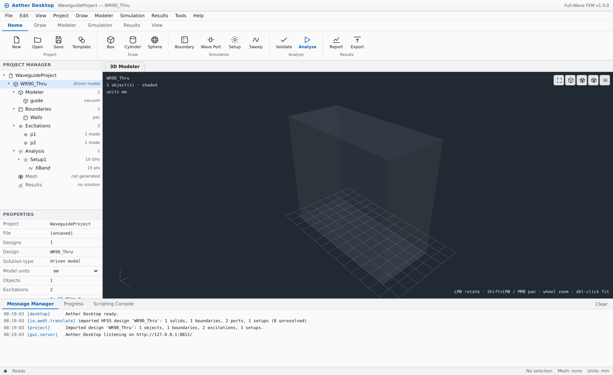
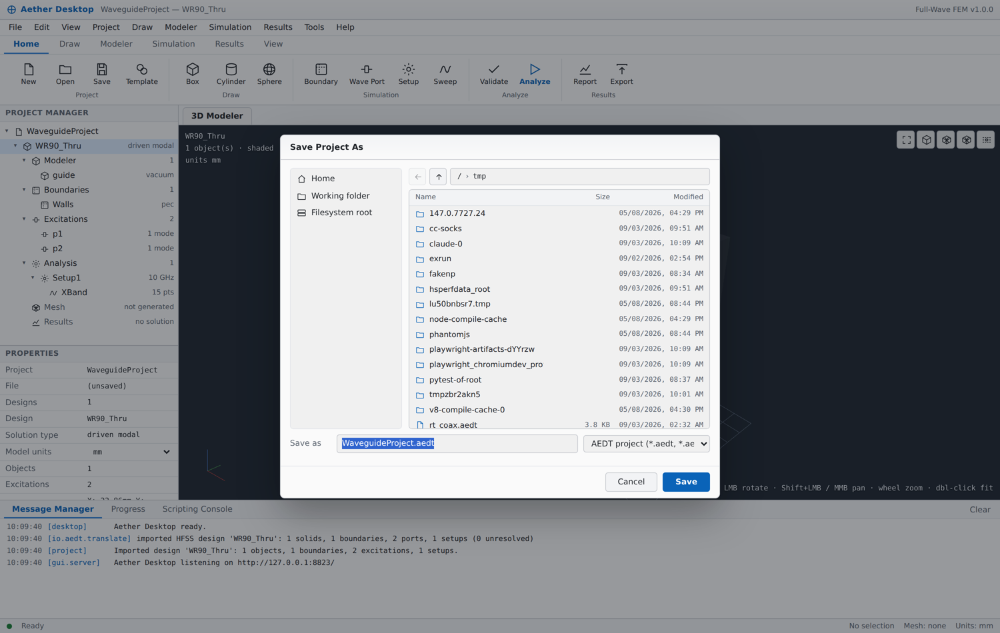

# Aether Desktop — the graphical workspace

```bash
aether gui
```

The command starts a local application server, opens your browser and hands
you a full EM workbench. Nothing is uploaded anywhere: the server binds to
`127.0.0.1`, the solver runs in your own process, and the browser is only the
window.



---

## 1. What is on screen

The layout follows the conventions of a professional EM workbench, so the
muscle memory carries over:

| Region | What it holds |
|---|---|
| **Menu bar** | File, Edit, View, Project, Draw, Modeler, Simulation, Results, Tools, Help |
| **Ribbon** | Home · Draw · Modeler · Simulation · Results · View, each with grouped icon commands |
| **Project Manager** (left) | the project → design → Modeler / Boundaries / Excitations / Analysis / Mesh / Results tree |
| **Properties** (left, below) | live, editable properties of whatever is selected |
| **Document area** (centre) | the 3-D Modeler plus a tab per report window |
| **Message Manager** (bottom) | every solver message, timestamped and colour-coded by severity |
| **Progress** (bottom) | stage, adaptive pass, frequency point, elapsed time |
| **Scripting Console** (bottom) | Python against the live model |
| **Status bar** | state, selection, mesh size, model units |

## 1a. The panels are yours to size

Every dock edge is a splitter. Drag the top edge of the Message Manager to
make it taller, the right edge of the Project Manager to make it wider, the
top of the Properties grid to trade it against the tree. Double-click a
splitter to restore its default; double-click the message tab strip (or use
the ▲ button) to collapse the panel to its tabs and back. The sizes are
remembered for the next run.

An import report is dozens of lines long. A fixed-height message panel is
therefore a panel you cannot read, which is the same as not having written
the report.

## 1b. Drawing happens in the viewport

`Draw ▸ Box by Points`, `Rectangle by Points` and `Cylinder by Points` open a
panel at the top-left of the viewport rather than a dialog over it:

    Box by points                     click the opposite corner
              X          Y          Z
    Cursor    12.4       6.0        0
    Corner 1  0          0          0
    Corner 2  12.4       6.0        0
    Size      12.4       6.0        0
    Height    [        ]
    Name  [Box1]   Material [vacuum]   Snap ✓  1mm

The cursor row follows the mouse. The corners fill in as you click. Every
other field is editable, and typing a value and pressing Enter does exactly
what clicking that point would have done — which is how you place a corner at
an exact coordinate without guessing pixels. The last Enter creates the
object. `Esc` steps back one point rather than throwing the draw away, and
`S` toggles snapping.

While you drag, the shape is previewed as a wireframe on the model with its
dimensions labelled beside it, and the status bar carries the cursor's model
coordinates at all times.

The numeric dialogs (`Draw ▸ Box`, and so on) are still there for when you
already know the dimensions and have no reason to point at anything.

## 1c. When the viewport looks empty

"It loaded and nothing appeared" has several quite different causes, and the
viewport alone cannot tell you which. `View ▸ Display Diagnostics…` states it
per object — displayed, no geometry, not drawable, hidden, or empty — with the
material, transparency and extent of each, and calls out the two cases that
look like a failed import and are not:

* **everything on screen is transparent.** Air, vacuum and PML regions carry a
  material transparency near 1. A model whose readable bodies are all regions
  of that kind renders as an almost empty window. `View ▸ Solid Display`
  ignores material transparency; it is switched on automatically, and said so,
  when a freshly opened project has nothing but near-transparent bodies.
* **the real parts are sub-pixel.** A patch inside a radiation box is a
  thousandth of its size, and `Fit All` fits the box. `View ▸ Fit Selection`
  (Ctrl+Shift+D, or *Zoom to Object* in the tree) frames the object instead.

A body that cannot be triangulated at all is drawn as its extent box and
counted in the viewport's corner readout rather than silently dropped, so the
count there always reads *drawn of total*.

## 1d. Selecting more than one thing

`O`, `F`, `E` and `V` choose what a click picks — objects, faces, edges,
vertices. **Ctrl+drag a rectangle** (or arm the box-select button in the
viewport toolbar) and everything of that kind inside the rectangle is
selected at once; hold Shift as well to add to what is already selected.
Picking one face at a time is workable on a box and hopeless on a coil.

Shift+drag and the middle button still pan, and plain left-drag still
rotates. Selecting several vertices reports how many, the widest span between
them and the box they occupy; selecting exactly two still measures the
distance between them.

## 1e. Moving with the mouse, to a number

`Edit ▸ Move by Two Points…` (Ctrl+M, the move icon in the viewport toolbar,
or an object's own right-click menu) takes what is selected and asks where it
should go:

    Move Patch                            click the destination
              X          Y          Z
    Cursor    31.0       12.0       0
    From      0          0          0
    To        31.0       12.0       0
    Delta     31.0       12.0       0
    Distance  [33.24]
    Copy [ ]   Snap [x]  1mm

Click a base point and a destination, or type the delta, or type a distance —
which keeps the direction you pointed in and changes only how far. The
selection's extent is previewed as a wireframe where it would land, with the
vector and its length labelled on the model. `Copy` leaves a duplicate
behind. Enter applies, Esc steps back.

## 1f. Sweep Face Along Normal is not Move Faces

They are two different commands and they do two different things:

* **Move Faces** drags the face; the body follows it, growing for a positive
  distance and trimming back for a negative one.
* **Sweep Face Along Normal** makes a *new body* out of the swept volume and
  leaves the face's own body exactly as it was — which is how a face of an
  existing part becomes an object with its own material, boundary or port.
  The new body is named for its source unless you name it.

## 2. Files: browse, don't type

Every place the application reads or writes a file opens a real browser:

* **File ▸ Open Project / Save Project As** — lists the machine the solver
  runs on, filtered to `.aedt` / `.aedtz`;
* **Draw ▸ Import CAD** — *Browse…* next to the path, filtered to STEP, IGES,
  BREP, STL and OBJ, the object name taken from the file, and the file's
  contents reported before you commit to it (see §4a);
* **Results ▸ Export** — *Browse…* in save mode, filtered to the chosen format
  with the extension added for you.

The dialog gives you Home / Desktop / Documents / Downloads / the working
folder and, on Windows, every mounted drive letter down the left; clickable
path segments across the top; back and parent buttons; and a list with size
and modified time. Double-click a folder to enter it, double-click a file to
accept it. Saving warns before replacing an existing file, and refuses a
folder that does not exist or is not writable rather than failing later.



If you would rather use the operating system's own picker, **System dialog…**
opens it. It runs in a short-lived subprocess — a GUI toolkit cannot be driven
from a server worker thread on Windows, and a crash inside it must not take
the workspace down. Where there is no desktop session the button is hidden and
the in-app browser is used.

`File ▸ Save Project` (Ctrl+S) writes straight back to the current file once
the project has one; `Save Project As…` (Ctrl+Shift+S) always asks.

## 2a. Closing a document, and being asked first

`File ▸ Close Project` (Ctrl+W) closes the open document and leaves the
workspace with no document at all — the state between projects — rather than
substituting a fresh empty one. The project tree says so and offers the two
ways back in. `File ▸ Exit` asks the same question and then stops the server:
closing the tab alone would leave the process holding its port.

Anything that would throw away unsaved work asks first, with three answers:

    Save changes to <project> before closing it?
        [ Cancel ]   [ Don't Save ]   [ Save ]

**Save** saves — asking where, if the project has never been saved — and then
carries on with what you were doing; backing out of that file browser cancels
the whole command rather than silently discarding the work. **Don't Save**
goes ahead. **Cancel** leaves everything exactly as it was. The prompt is
raised by New Project, New from Template, Open Project, Close Project and
Exit, and by closing the browser tab.

Designs are managed from the tree: right-click one for *Set as Active Design*,
*Rename Design…*, *Insert Design* and *Delete Design*; right-click the project
for Save, Save As, Insert Design and Close. The last design in a project
cannot be deleted — closing the project is what you want there.

## 2b. Long operations say what they are doing

Opening a project, importing a CAD assembly and rebuilding the display buffers
take real time on a real model. Each publishes its stage, the item it is on
and how many of how many, and the workspace shows that as an overlay across
the window and in the **Progress** panel at the bottom. A stage with no
countable total animates rather than inventing a percentage.

That channel is answered by its own request, separate from the one running the
command, which is why it keeps updating while the command holds the session
lock — the alternative is a window that reports nothing until the work it is
reporting on has already finished.

## 3. Names are generated for you

You never have to invent a name. Every creation dialog opens with the next
free one already filled in — `Box1`, `Box2`, `Cylinder1`, `PerfE1`, `Rad1`,
`Port1`, `Setup1`, `Sweep1` — and clearing the field is fine, the server names
the object either way. The rule is the lowest free integer, so a project
holding `Box1` and `Box3` proposes `Box2`.

Suggestions come from the server, so they account for objects created in the
scripting console or loaded from a project file, not just the ones this dialog
made. Typing a name that is already taken advances its trailing number
(`Box7` becomes `Box8`) instead of appending a second one. A CAD import is
named after its file.

## 4. The workflow

1. **Start a model** — `File ▸ New from Template…` gives a complete, solvable
   project (WR-90 waveguide, 50 Ω coax, or a parallel-plate line with lumped
   ports). `File ▸ Open Project…` reads any `.aedt` / `.aedtz`.
2. **Draw** — Box, Cylinder, Sphere, Cone, Torus, Rectangle sheets, or
   `Import CAD…` for STEP / IGES / BREP / STL. Every length field takes units
   (`22.86mm`, `0.9in`, `25mil`).
3. **Combine** — `Modeler ▸ Boolean` (subtract / unite / intersect), and the
   `Edit` menu for arranging, copying and duplicating (see §4b).
4. **Assign boundaries** — Perfect E, Perfect H, Radiation, Finite
   Conductivity (with thickness and roughness), Impedance, Lumped RLC,
   symmetry planes.
5. **Assign excitations** — wave ports (modes, de-embedding, renormalisation,
   integration line) and lumped ports (impedance, field direction).
6. **Set up the analysis** — solution frequency, adaptive passes, ΔS target,
   basis order, and any number of frequency sweeps.
7. **Validate** (`F5`) then **Analyze** (`F9`). The Progress panel tracks
   meshing → adaptive passes → sweep; the Message Manager carries the detail.
8. **Read the results** — the S-parameter report opens automatically when the
   solve finishes.

## 4a0. What a CAD file carries besides its parts

A STEP export is not only its solids. One written by HFSS through Spatial
InterOp also carries presentation geometry: free faces of hundreds of square
metres and free curves tens of metres long, in an assembly whose largest part
is forty-eight millimetres. Nothing in the model refers to them and nothing
draws them, but a surface mesher meshes every entity it is given — at the
element size chosen for the *parts* — so a 600 KB file could take an hour and
several gigabytes and still not finish.

Two rules keep that bounded, for the inspection pass as well as the display:

* only the entities the displayed bodies actually use are meshed; everything
  else is dropped first (1,995 entities, in the file this was found in);
* the element size is solved against a triangle budget — 900,000 by default,
  `AETHER_VIEW_MAX_TRIS` to change it — rather than taken on trust. When a
  model needs a coarser display seed to fit, the Message Manager says so.

Both are display and inspection limits. The FEM mesh is sized by physics and
is not affected.

A DXF gets a similar tolerance. A layout tool writes tenth-of-a-micron steps
into a forty-five millimetre outline; OpenCASCADE refuses to build an edge
shorter than its own confusion tolerance, and one such step used to be
reported as "Could not create line" and lose the whole drawing. Rings are
cleaned against their own size with a one-micrometre floor, and an outline
that still cannot be built is skipped and named rather than taking the rest
with it.

Reading a file costs one read and one surface mesh, and that mesh is the one
the viewport draws — inspection used to read the file twice and mesh it twice,
and the viewport then meshed it a third time. Commands that make geometry also
work on an empty workspace: with no project open they create the document they
need rather than refusing.

## 4a. Importing CAD: the unit is the whole game

A STEP or IGES file stores bare numbers — `20.0` — and declares separately what
they mean. Aether works in metres throughout, so a file that means 20 mm and is
read as 20 metres produces a part a thousand times too large: the camera fits
to it, everything else in the model becomes an invisible speck, and the import
looks as though nothing happened at all.

So the importer never guesses silently:

* the file's own declaration (`SI_UNIT(.MILLI.,.METRE.)`, `CONVERSION_BASED_UNIT('INCH')`,
  the IGES global-section unit name) is read and applied — this is **Auto**;
* **Model units** in the dialog overrides it for the files that declare nothing
  or declare wrongly: metre, centimetre, millimetre, micrometre, inch, mil,
  foot. STL and OBJ declare no unit anywhere and are read as millimetres unless
  you say otherwise;
* the moment a file is chosen, and again whenever the unit is changed, the file
  is **inspected** and the dialog reports what is in it: format, solid count,
  face count, the extent it will land at in millimetres, and the unit applied
  against the unit declared. A scale error is visible *before* the import, not
  after;
* the same line goes into the Message Manager when the import completes, so it
  is in the project record too;
* a file with surfaces but no closed solid says so — that geometry can be
  displayed but not meshed as a volume, and is usually a sign the source needs
  re-exporting as a solid;
* ACIS `.sat` is refused with an explanation rather than a stack trace:
  OpenCASCADE cannot read Spatial's format. Export STEP AP214 instead.

**One read per file, not one per body.** Measuring the parts, listing them and
drawing them are all served from a single import: a twelve-part assembly is
read about three times in total rather than thirty. Doing it per body is what
made a large import look like a hang and hold the geometry in memory once per
part. Results are cached on the file's path, size and modification time — and
on *which body*, without which every part of an assembly drew as whichever one
was tessellated first. The display cache is bounded by the number of triangles
it holds rather than by a count of entries, since a cache of 24 assemblies is
a different amount of memory from a cache of 24 boxes.

**Paths with non-ASCII characters** — a Korean folder name, an accented part
number — are handled by copying to a temporary ASCII name for the kernel.
OpenCASCADE takes narrow file names, and on Windows such a path reaches it
mangled and the read simply fails.

**A file that will not read** says which file and what to try (re-export as
STEP AP214; save a mesh as STL) instead of surfacing a kernel error.

**Choosing the file.** *Browse…* opens the file browser **on top of** the
Import dialog and returns to it with the path filled in; the browser also
accepts a full path typed or pasted into its name box, and reopens where you
were last time for that kind of file. (Before 1.2 the browser replaced the
dialog that opened it, so picking a file destroyed the import that was waiting
for it — the button appeared to do nothing at all.)

**After the import.** The body is an ordinary object: rename it, change its
material, move, rotate, mirror, scale, duplicate or boolean it, assign
boundaries and ports to its faces. Two more properties are its own, both in the
property grid and both editable in place:

* **Model units** — re-reads the same file at another unit, which is the
  one-step fix when a file declared the wrong thing;
* **Replace source… / Locate file…** — points the object at a different file,
  or at a newer revision of the same one (`Modeler ▸ Replace CAD Source…` does
  the same from the menu).

Both edit the existing object rather than making a new one, so its name, its
material, the transforms applied to it and every boundary and port assigned to
it survive the change.

**Repairing a whole import at once.** An HFSS project whose parts are stored as
ACIS or Parasolid attachments arrives with every name, material, boundary and
port intact and no geometry at all: those are proprietary kernel formats, and
nothing outside their own kernel can read them. What the engineer has is one
STEP export of the same assembly, so `Draw ▸ CAD ▸ Repair Bodies`
(`Modeler ▸ Repair Bodies`) reads that file once, matches its bodies to the
placeholders by name, and shows the mapping — with each candidate's true extent
in millimetres, so a part can be identified by its size when the export carries
no names — for correction before anything is changed. Bodies left unmapped stay
as they were.

**Saving.** `File ▸ Save Project` copies each imported CAD file into a
`<project>.cad` folder beside the `.aedt` and records it as a relative path, so
the project opens correctly after it is moved, copied or sent to a colleague.
The original absolute path is kept as a fallback. If neither can be found the
part is still loaded — with its boundaries, ports and transforms intact — and
the Message Manager says which file is missing so it can be pointed at again
with *Locate file…* rather than the model quietly coming back incomplete.

Exports are written to match: STEP and IGES are stamped with millimetres *and*
written in millimetres, so a file Aether writes reads back at the same size in
Aether, in HFSS, and in any mechanical CAD system.

### Assemblies arrive as parts

A multi-body STEP is imported as **one object per body**, named from the CAD
label where the file carries one, so each part can be given its own material,
assigned to, moved or deleted. *Import as a single body* is there for the
cases where the assembly really is one thing.

Shape healing is applied only when a file turns out to need it. Healing sews
faces together, and sewing an assembly welds every part into one compound that
then fails to become a solid — a perfectly good three-part STEP used to arrive
as fifteen loose faces and no solids at all: one lump that could be neither
split nor meshed. The file is read as-is first, and healed only if that
produced nothing solid, which is the case healing was meant for.

### AutoCAD drawings

`.dxf` is read directly — no third-party library, so an air-gapped install
reads drawings too. LINE, LWPOLYLINE (arcs and bulges included), POLYLINE,
CIRCLE, ARC, SOLID and POINT are understood, on any layer, and the drawing's
`$INSUNITS` is honoured (a drawing that declares nothing is read as
millimetres, which is what PCB and mechanical tools export).

A DXF is a drawing, not a model, so what it yields is **outlines**: each
closed one becomes a sheet, and an outline that lies inside another is cut out
of it — which is what a mounting hole, a slot or a coupling gap is. From
there, one **Sweep Face Along Normal** gives the outline its thickness and it
becomes a solid: an antenna trace drawn in AutoCAD is 35 µm of copper in two
steps.

## 4b. Editing: arrange, clipboard, duplicate, undo

Everything under **Edit** acts on the current selection — pick objects in the
viewport or the tree, then act — and every one of them is a single undo step.

| Command | Shortcut | What it does |
|---|---|---|
| Undo / Redo | `Ctrl+Z` / `Ctrl+Y` | 40 steps deep, labelled with the operation (*Undo Move*) |
| Cut / Copy / Paste | `Ctrl+X` / `Ctrl+C` / `Ctrl+V` | full objects with their material and solve-inside flag |
| Paste at Offset… | — | pastes displaced by a vector |
| Duplicate ▸ Along Line… | `Ctrl+D` | *n* copies stepped by a vector |
| Duplicate ▸ Around Axis… | — | *n* copies about X/Y/Z through a point |
| Duplicate ▸ Mirror… | — | one reflected copy |
| Arrange ▸ Move / Rotate / Mirror / Scale… | — | on any number of objects at once |

Points to note, all of them places where modellers differ from one another:

* **Count is the total, including the original.** Four around a full circle
  means quadrants — the original plus three more at 90° — which is the
  convention every mechanical modeller uses.
* Around Axis takes either the **whole** angle to spread the pattern over
  (the default, so `360deg` with 4 gives 90° steps) or the angle **per step**,
  by clearing the checkbox.
* **Attach copies to the original** unites the pattern into one object, the way
  you would build a comb filter or a via fence as a single body.
* Pasted and duplicated objects are named without collisions on the same rule
  as §3, so `Box1` duplicated four times gives `Box2`…`Box4`.
* Undo restores the whole design in one piece, so a boundary or port that
  referred to a deleted object still refers to it after the undo, rather than
  to an orphaned copy of it.
* Items that cannot do anything yet — Paste with an empty clipboard, Undo with
  no history — are greyed out rather than failing when clicked.
* A command that fails leaves no entry in the history, so undo never rewinds
  past something that never happened.

Every one of these is also a command on the API layer, so the console can do
the same: `rpc('modeler.duplicate', {names:['Via1'], mode:'line', count:8,
params:{vector:['1mm','0mm','0mm']}})`.

## 4c. Selecting: objects, faces and edges

Selection is not decoration — it is how every assignment and every face
operation is told *where*. The viewport has three pick modes, on the toolbar
and on the keyboard, exactly where a modeller puts them:

| Mode | Key | What a click gives you |
|---|---|---|
| Object | `O` | the whole body |
| Face | `F` | one face of one body, highlighted on its own |
| Edge | `E` | the nearest boundary edge of the face you clicked |

Ctrl (or Shift) click adds to the selection; clicking empty space clears it.
The status bar reports what is picked and the number you are usually checking
when you pick it — total **area** for faces, total **length** for edges — so
"did I get the whole patch or half of it?" is answered without a measurement
tool.

Faces come from the CAD kernel, so a box has six of them, a cylinder three
(wall plus two caps) and an imported STEP body exactly the faces it was built
with. Without a kernel installed the viewport groups its own triangles into
faces by continuity, which gives the same answer for the primitives.

**A pick is geometry, not an index.** What gets stored is a point on the face,
its outward normal and its extent — never "face 4". Face numbering changes
whenever the model is rebuilt, so an index-based assignment would quietly move
to a different face after any edit; a geometric one survives remeshing, every
adaptive pass, a change of mesh size and a reopened project.

Picked faces feed straight into:

* **Boundary and excitation assignment** — the *Assign to* list offers
  *Picked faces* and pre-selects it whenever something is picked, so the
  natural order (pick, then assign) works;
* **Mesh operations** — see §4d;
* **Face modelling** — see §4e.

### Right-click

The viewport and the project tree both have a context menu, holding the
commands that apply to whatever is under the cursor: the three pick modes,
Assign Boundary / Wave Port / Lumped Port, Add Mesh Operation, Sweep Face
Along Normal, Move Faces, Arrange, Duplicate, Boolean, Copy / Paste / Delete,
Fit All and Properties. Right-clicking an object also selects it first, so
"right-click the thing, then pick the command" works the way it does in any
modeller. In the tree the menu is per node: an object offers Rename, Hide,
Show All and its assignments; a boundary, port, setup or mesh operation offers
Properties and Delete; the Modeler node offers the draw commands and Import
CAD.

### Measuring

Every pick answers the question you had when you clicked it, in the model's
own units, shown at the bottom-left of the viewport:

| Picked | Reported |
|---|---|
| one edge | its length |
| two edges | both lengths and the distance between them |
| one face | its area and its extent |
| two faces | the gap between them, whether they are parallel, and the plane spacing when they are |
| objects | the overall size, and the gap between two of them |

The distance is the **minimum** separation, not the distance between centres:
two faces of very different size, or offset from one another, have a gap that
has nothing to do with the distance between their middles. The span it
measured is drawn in the viewport with the number floating over it, so what
was measured is never in doubt.

## 4c-2. Ports by picking

A port is a statement about two pieces of metal — this conductor against that
return — and that is how it is specified here.

`Simulation ▸ Excitations ▸ Lumped Port (pick)`, or *Port by Picking* in the
viewport's right-click menu:

1. click the **signal** conductor's face — the flow moves on to ground by
   itself;
2. click the **ground** face;
3. check the impedance and press **Apply**.

The sheet a lumped port needs is created across the gap, no wider than the
narrower of the two picks, and the **integration line runs ground → signal**.
That direction is not cosmetic: it fixes the sign of V and therefore of the
port impedance, and it is the part that is easiest to get wrong when the sheet
is drawn by hand.

`Wave Port (pick)` assigns the port to the picked cross-section. A second,
optional pick on the return conductor adds the integration line that turns the
modal wave impedance into V²/2P — which is what a coax, a microstrip or any
other TEM line needs.

While the flow is live: **Ctrl+click** adds faces to whichever side is armed,
**S** and **G** re-arm the signal and ground rows, **Esc** cancels and
**Enter** applies. Nothing is created until Apply.

The dialog forms (`Wave Port…`, `Lumped Port…`) are unchanged and still take a
plane, a bounding-box face, an object or the picked faces.

### What an assignment reports

Every boundary and port says how many face triangles it actually covers, and
warns in the Message Manager when that is **zero**. A boundary that is in the
tree, solves, and is not on the model is the quietest way to get a wrong
answer, so it is called out at the moment it is assigned rather than left to
be discovered in the results.

## 4d. Mesh operations

`Simulation ▸ Add Mesh Operation…` refines the initial mesh where you already
know resolution is needed — a narrow feed, a coupling gap, the rim of a patch
— rather than waiting for the adaptive passes to discover it and paying for a
globally finer mesh in the meantime.

* Applies to **objects** or to the **picked faces**;
* *Max element length* is the only number, stated in model units;
* Operations appear under **Mesh** in the project tree, each editable and
  individually switchable in the property grid;
* A face refinement is kept local: the fine size at the face's rim is not
  allowed to propagate through the body, so the opposite side of a thin
  substrate stays as coarse as you asked for.

## 4e. Face modelling: sweep and move

`Modeler ▸ Sweep Face Along Normal…` and `Modeler ▸ Move Faces…` work on the
picked faces:

* **Sweep** extrudes the face along its own normal and adds the swept volume —
  the way a sheet becomes a solid or a patch gains its thickness;
* **Move** drags the face itself: positive grows the body, negative trims it.

Both are recorded on the object as *an operation over that face*, not as a new
lump of geometry, so the distance stays editable, the operation replays
whenever the model is rebuilt, and the object keeps its name, its material and
every boundary and port assigned to it. Each is a single undo step, and both
are written into the project file and read back.

Two things they deliberately will not do:

* **a curved face is refused** — "along the normal" has no single direction on
  a cylinder wall or a fillet, and quietly picking one produces a body that is
  not what anyone asked for. Pick a planar face, or scale the whole body;
* **an operation that cannot be applied is reported, not drawn** — if the face
  it refers to is no longer on the body, the operation is undone and the error
  says so, rather than the viewport falling back to a bounding box that looks
  like a result.

They also only ever touch the body they belong to: with a whole design built
into one modelling session another object's face can sit exactly where the
recorded one does, and matching is restricted to the body's own faces so a
sweep cannot deform a neighbour.

## 4f. Drawing from the screen

Numbers are right when you know them. Often you know *where* instead — on this
face, from that corner, out to about there. **Draw ▸ Box / Rectangle /
Cylinder by points** (also on the Draw ribbon) takes two clicks:

1. the first point fixes the origin — clicking a body puts it exactly on that
   body, clicking empty space puts it on the working plane you can see as the
   grid;
2. the second fixes the opposite corner, with the outline rubber-banding and
   its running dimensions shown as you move.

The creation dialog then opens **already filled in** with those numbers, to be
corrected rather than invented. `S` toggles snapping to the grid step, `Esc`
cancels.

## 4g. Seeing the assignments

Boundaries and ports are drawn on the faces they cover, colour-coded by type,
with a legend naming each one (click a legend row to open its properties) and
a port's integration line drawn on top. The overlay is on by default and has
its own viewport button.

This needs no mesh: the selectors are geometric, so they are evaluated against
the displayed triangles directly — which means what is drawn is exactly what
the mesher will tag. An assignment that landed on the wrong face is obvious at
the moment it is made, instead of at the end of a solve.

## 5. The 3-D modeller

Rendered by a small WebGL engine that ships with the package — no CDN, no
external library, so it works on an air-gapped workstation.

| Action | Input |
|---|---|
| Select | click an object; Ctrl/Shift-click to add; click empty space to clear |
| Rotate | left-drag |
| Pan | shift + left-drag, or middle-drag |
| Zoom | wheel |
| Fit all | double-click, `F`, or the ⛶ button |
| Orientation | `View ▸ Iso / Top / Front / Right` |
| Display | shaded ⇄ shaded + edges ⇄ wireframe |
| Mesh overlay | the mesh button, or `Results ▸ Mesh View` |
| Field overlay | `Results ▸ Field Overlay` (needs *Save fields*) |

Objects are drawn with their material's colour and transparency; the selected
object is highlighted, and the ground grid auto-scales to the model.

**Per-object display.** The property grid gives each object its own **Colour**,
**Transparency** and **Visible** setting. They start from the material's and
each has a *reset* next to it once overridden — a red patch on a red substrate
is a modelling problem, not a material one, and it should be fixable without
inventing a material to fix it. A hidden object is neither drawn nor
pickable, and stays in the model and in the solve.

Selection is a ray cast against the very triangles that were uploaded for
drawing, so it costs nothing per frame and cannot be fooled by transparency or
by the ground grid.

What you see is what gets solved: solids are tessellated through the same
OpenCASCADE kernel that feeds the mesher, so a boolean cut or an imported
STEP body is displayed exactly as it will be discretised.

## 6. Reports

* **S-Parameters** — dB, magnitude, phase, VSWR or group delay; pick any
  subset of S(i,j) with the trace chips; passivity and reciprocity are stated
  in the header; a data table follows the plot.
* **Port Modes** — per port and mode: type (TE/TM/TEM/hybrid), β, α, cutoff
  frequency, wave impedance and port impedance. Lumped ports appear too, as a
  single TEM row from their definition.
* **Convergence** — the adaptive pass history with tetrahedron count, DOF and
  ΔS.
* **Export** — Touchstone `.sNp`, CSV, a standalone HTML report, or field data
  as `.vtu` for ParaView.

## 7. The scripting console

The bottom dock's console runs Python against the **same objects** the UI is
showing — `design`, `project`, `solution`, and `ae` (the package). Ctrl+Enter
runs; anything the script changes appears in the tree and the viewport
immediately, because there is no second copy of the model.

```python
for w in (8, 9, 10, 11):
    design.add_box(f'stub{w}', (f'{w}mm', 0, 0), ('1mm','1mm','5mm'), 'copper')
```

Everything the UI does is a command on the same layer
(`aether.gui.api.COMMANDS`), so a UI action and a script call are
interchangeable.

## 8. Command-line options

```bash
aether gui                                # open with an empty project
aether gui --template waveguide           # start from a template
aether gui --project my.aedt              # open an existing project
aether gui --port 8800 --no-browser       # fixed port, don't launch a browser
aether gui --host 0.0.0.0                 # expose on the network (see below)
```

## 9. Security

The console executes Python, so the endpoint is treated as privileged:

* the server binds to **loopback only** unless you pass `--host` explicitly;
* every API call carries a random per-run token embedded in the page URL, so
  another site open in your browser cannot drive your session;
* static file serving is path-traversal checked.

`--host 0.0.0.0` exposes a Python execution endpoint to your network. Only do
that on a trusted network, and keep the token.

## 10. Requirements

The workspace needs a browser with WebGL — every current desktop browser
qualifies. The server itself uses only the Python standard library; there is
no Node toolchain and no build step.

## 11. Tests

```bash
pytest tests/test_gui.py -q               # API, server, tessellator (headless)
pip install playwright && playwright install chromium
pytest tests/test_gui_browser.py -q       # drives the real UI in Chromium
```

The browser suite clicks through the whole workflow — draw, boolean, assign,
validate, mesh, solve, plot, script — and asserts on what the page actually
renders, including that the WebGL framebuffer is not blank. It finishes with a
sweep that clicks **every menu item and every ribbon button** and fails if any
of them throws, which is what keeps the answer to "does
everything still work?" honest.
